# 🏰 kingdom

> Every machine is a realm that you need to defend.

**kingdom** is a configuration of linux based on privacy, performance, aesthetic,
hacking and development. You answer a few questions, pick what you want, and come
back to a system that boots into GNOME or Hyprland (with the caelestia shell),
encrypted, snapshotted and guarded from the first login.

## The realm

- **The soil** → GRUB
- **The King** → Arch Linux
- **The walls** → LUKS2
- **The chronicle** → btrfs
- **The granary** → zram
- **The gates** → nftables & usbguard
- **The watchtower** → AIDE & ClamAV
- **The main road** → GDM
- **The two courts** → GNOME & Hyprland with caelestia
- **The crusade** → a Kali lab, only through the VPN

Everything it does, in detail: [FEATURES.md](FEATURES.md).

## Install

You need a UEFI computer, internet and a backup of anything you care about.

### Option A: official Arch ISO

1. Download the [official Arch ISO](https://archlinux.org/download/):

   ```
   curl -LO https://geo.mirror.pkgbuild.com/iso/latest/archlinux-x86_64.iso
   ```

2. Find your USB stick (for example `/dev/sdb`) and write the ISO to it.
   Everything on the stick is erased:

   ```
   lsblk
   ```
   ```
   sudo dd if=archlinux-x86_64.iso of=/dev/sdX bs=4M status=progress oflag=sync
   ```

3. Boot it and connect to Wi-Fi if needed (with a cable, skip this):

   ```
   iwctl station wlan0 connect "Network name"
   ```

4. Download kingdom:

   ```
   curl -L https://github.com/LordMikkel/kingdom/archive/refs/heads/main.tar.gz | tar xz
   ```

5. Start it:

   ```
   bash kingdom-main/install/install-generic.sh
   ```

### Option B: kingdom ISO

1. Download `kingdom-*.iso` from
   [Releases](https://github.com/LordMikkel/kingdom/releases):

   ```
   curl -LO https://github.com/LordMikkel/kingdom/releases/download/v0.0.1/kingdom-2026.10.20-x86_64.iso
   ```

2. Find your USB stick (for example `/dev/sdb`) and write the ISO to it.
   Everything on the stick is erased:

   ```
   lsblk
   ```
   ```
   sudo dd if=kingdom-2026.10.20-x86_64.iso of=/dev/sdX bs=4M status=progress oflag=sync
   ```

3. Boot it and connect to Wi-Fi if needed (with a cable, skip this):

   ```
   iwctl station wlan0 connect "Network name"
   ```

4. Start it:

   ```
   bash /root/dotfiles/install/install-generic.sh
   ```

The ISO already carries kingdom; it still downloads the packages, so it still
needs internet.

## Step by step

Every window has **Back**. A wrong answer is explained and asked again.
Nothing is written to disk until step 6.

1. **Your computer:** name, user, time zone, keyboard and passwords.

   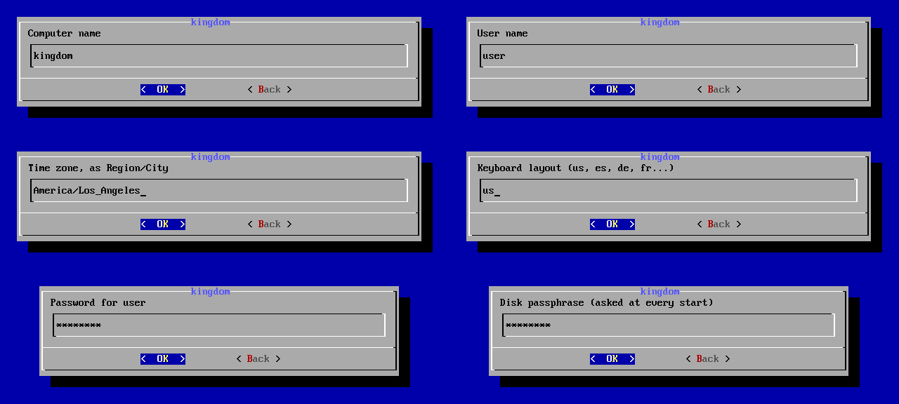

2. **What you get.** *Full list* shows every package.

   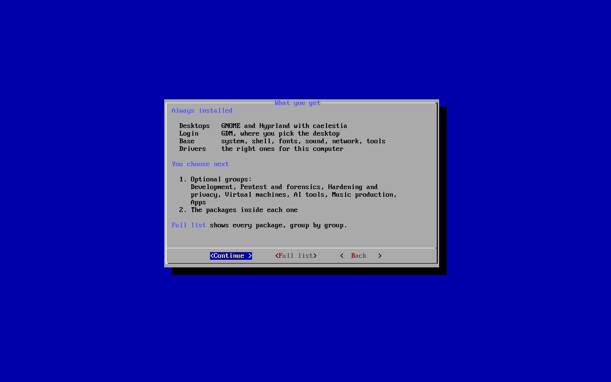

   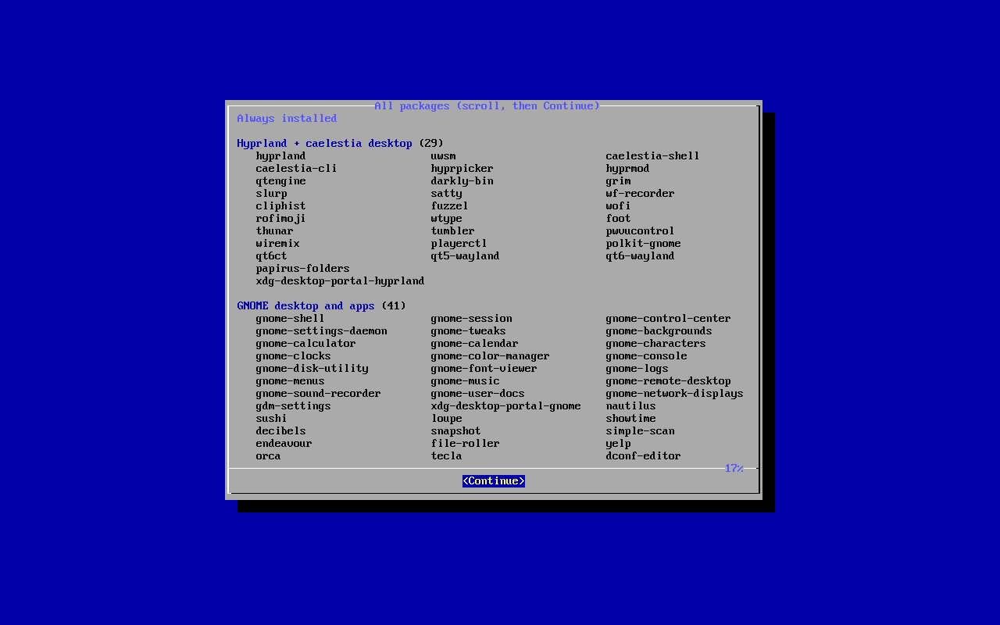

3. **Optional groups.** `Space` marks or unmarks, `Enter` continues.

   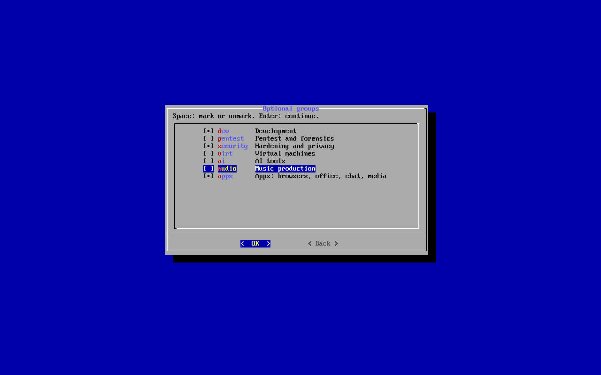

4. **Packages of each group.** Unmark what you do not need.

   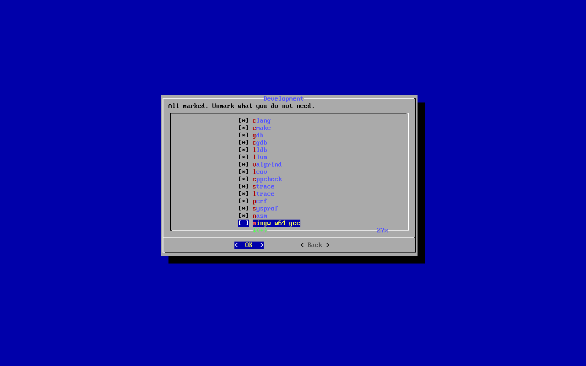

5. **Where to install:** free space next to Windows, a whole disk, or one
   partition. In free space, type the size in GB (50 or more, or `max`).

   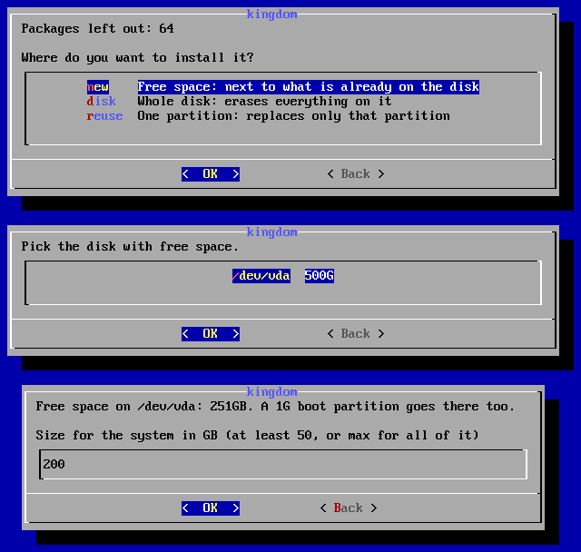

6. **Ready to install.** Type `INSTALL` (or `ERASE` when something is erased).
   It then works alone until it says *Done*: remove the USB and restart.

   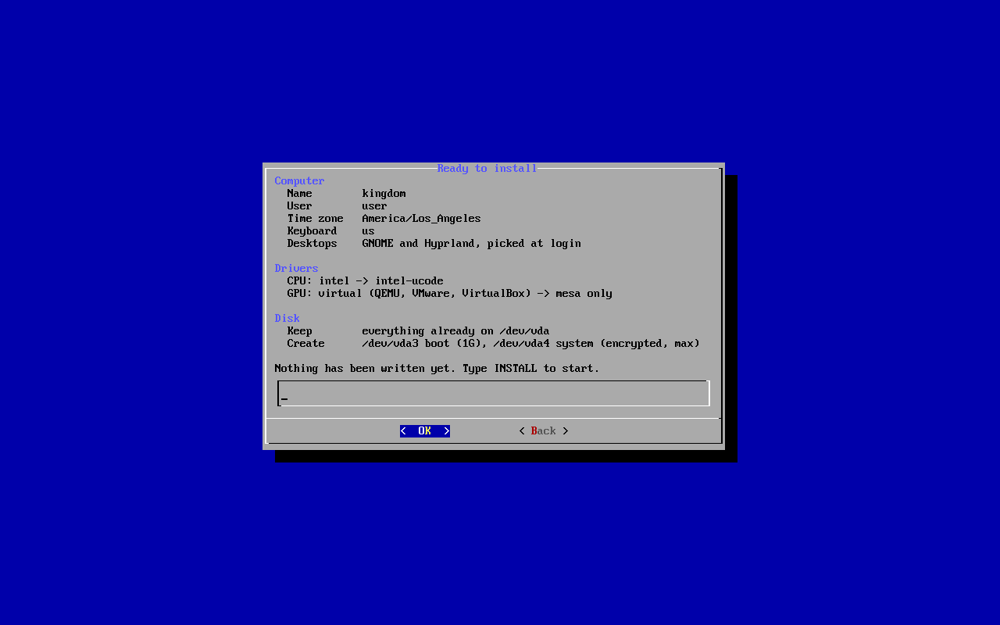

7. **GRUB.** Press `Enter`.

   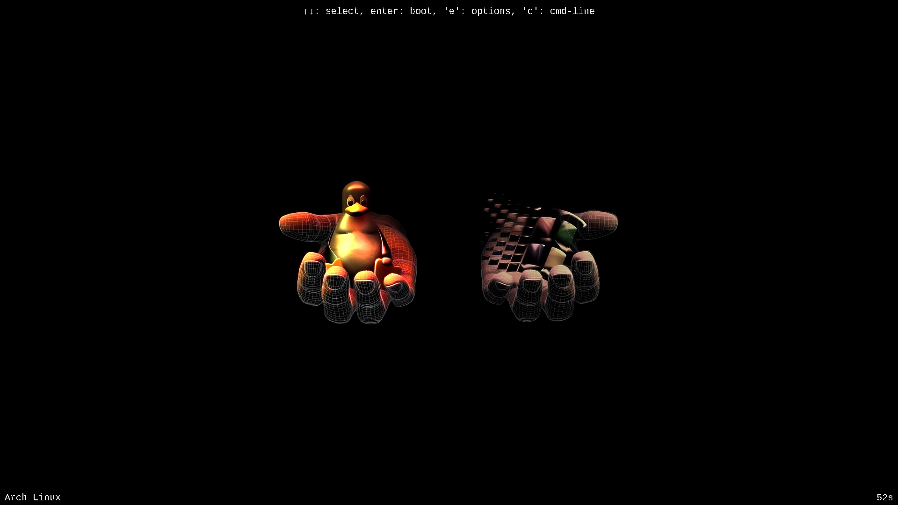

8. **Disk passphrase.**

   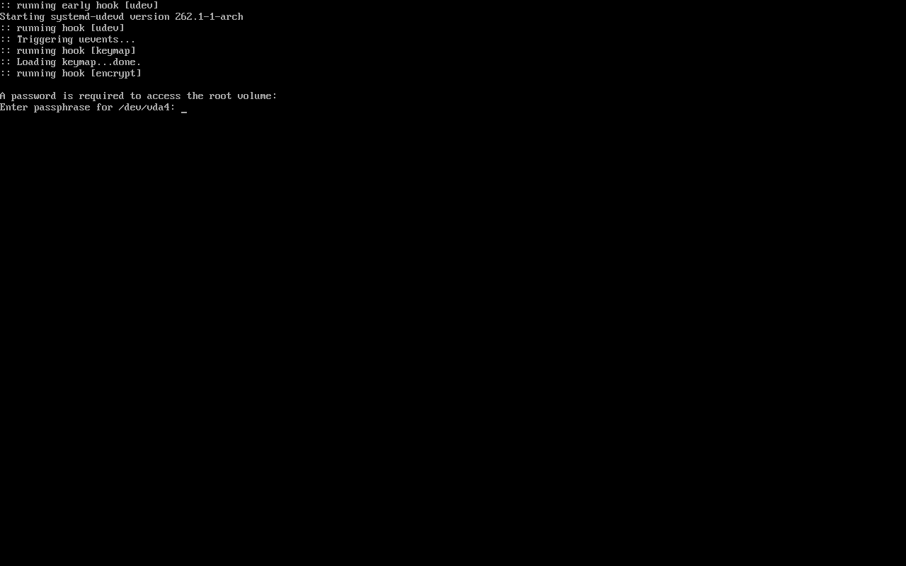

9. **Log in.**

   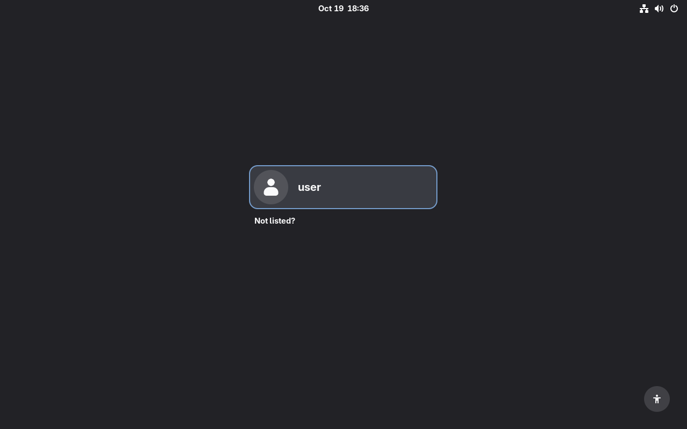

10. **Pick the desktop** with the gear, bottom right. It is remembered.

    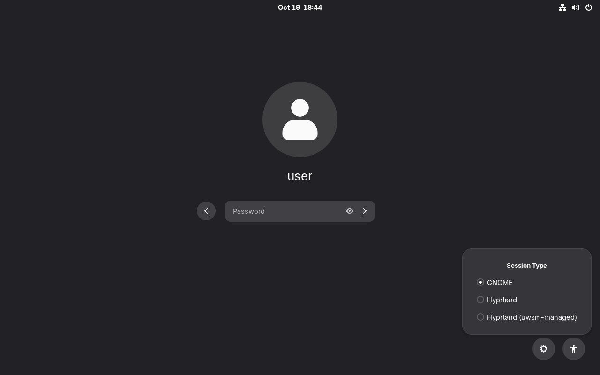

    Hyprland with caelestia

    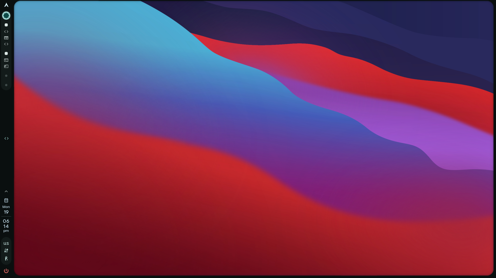

    GNOME

    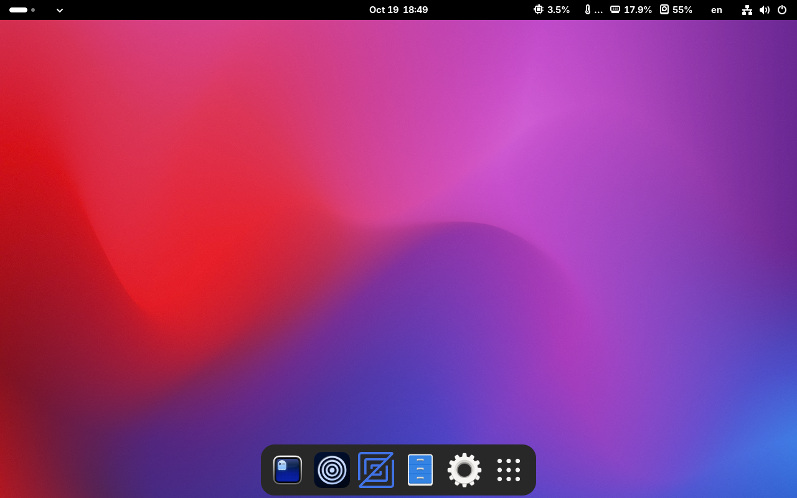

## Credits

- Made by [LordMikkel](https://github.com/LordMikkel), built and tested
  together with Claude Code as a pair programmer.
- [Arch Linux](https://archlinux.org) and its wiki, the ground everything
  stands on.
- [caelestia](https://github.com/caelestia-dots) shell and CLI, with a few
  local tweaks in `caelestia-tweaks/`.
- [Hyprland](https://hyprland.org) and [GNOME](https://www.gnome.org).
